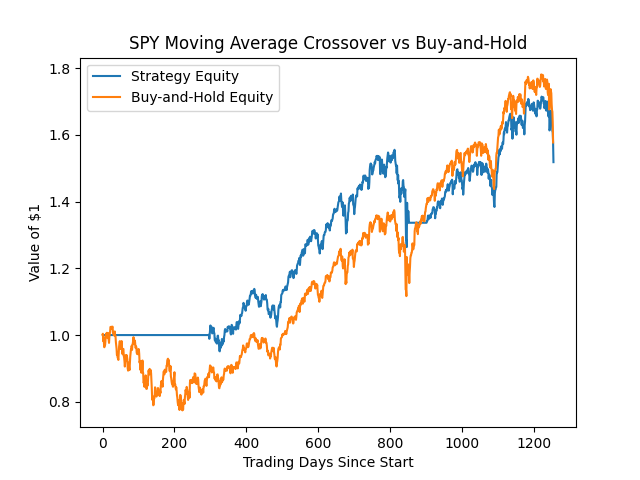

# Stochastic Market Engine

A Monte Carlo forecasting and risk tool for equities. It calibrates a Geometric
Brownian Motion (GBM) model on a real stock's history, simulates hundreds of
possible one-year price paths, and reports risk metrics on both the real data
and the simulated futures.

It also ships with an interactive learning demo (a risk-level slider) for
building intuition about volatility.

## What it does

- **Calibrates on real data.** Pulls a ticker's history with `yfinance` and
  estimates annual drift (`mu`) and volatility (`sigma`) from its daily log
  returns.
- **Simulates forward.** Runs a vectorized GBM Monte Carlo of many price paths
  over a one-year horizon (daily steps).
- **Scores risk.** Computes the Sharpe ratio and maximum drawdown on the real
  history, plus the median simulated max drawdown across paths.
- **Visualizes it.** Draws a fan chart of the simulated paths anchored to the
  stock's recent real price, with percentile bands and a "today" line.

## Methodology

GBM models the price as `S_t = S_0 * exp((mu - 0.5*sigma^2)*t + sigma*W_t)`.
Calibration inverts the daily log returns:

- `sigma_annual = std(log_returns) * sqrt(252)`
- `mu_annual = mean(log_returns) * 252 + 0.5 * sigma_annual^2`

Metrics:

- **Sharpe ratio** = `mean(excess returns) / std(excess returns) * sqrt(252)`
- **Max drawdown** = the largest peak-to-trough drop along a price path.

## Install

```bash
pip install -r requirements.txt
```

## Usage

```bash
python main.py
```

Then pick option **1** and enter a ticker (e.g. `AAPL`). The tool prints the
calibrated parameters and risk metrics, then opens the forecast chart.

Menu:

1. Forecast a real stock (Monte Carlo + risk metrics)
2. Explore risk levels (learning demo)
3. Compare two risk levels side-by-side
4. Quit

## Backtest: moving-average crossover vs buy-and-hold

`backtest.py` tests a simple trend-following strategy on real data and compares
it to buying SPY and holding it.

**Strategy.** Hold SPY when its 50-day moving average is above its 200-day
moving average, otherwise hold cash (cash earns 0%). The signal is computed from
each day's close and traded the next day, so the strategy never uses
information it could not have had. Every change in position costs 10 basis
points (0.1%).

**Data.** Five years of daily adjusted SPY closes from `yfinance`. The first 199
days have no 200-day average, so the strategy stays in cash until one exists
and the 50-day average crosses above it.

```bash
python backtest.py
```

This prints the metrics below and saves the chart to `equity_curve.png`.



### Results

| Strategy                              | Total return | Sharpe ratio | Max drawdown |
| ------------------------------------- | -----------: | -----------: | -----------: |
| 50/200-day moving-average crossover   |       51.84% |         0.72 |      -18.76% |
| Buy-and-hold SPY                      |       57.74% |         0.61 |      -24.50% |

*SPY, five-year window as of 22 Nov 2026, 10 bps per trade, risk-free rate 0.*

Buy-and-hold earned more in total, but the crossover strategy had the higher
Sharpe ratio and the shallower worst drop. It spent the early part of the window
in cash, which let it avoid a large drawdown, and it was late to get back in
after the April 2025 sell-off, which is where buy-and-hold caught up.

### Limitations

- **One stock, one parameter pair.** Only SPY and a 50/200-day crossover were
  tested, so the result may not generalize to other stocks or market regimes.
- **Very few trades.** The run produced only three trades, which is too few to
  conclude that the strategy has an edge. The Sharpe gap could easily be luck.
- **Moving data window.** The five-year window is measured back from today, so
  results shift slightly over time. A fixed start and end date is planned.
- **Simplified costs.** Costs are a flat 10 bps per trade, with no slippage or
  bid-ask spread, and the results exclude dividends and taxes.

### What I learned

**Python**

- `rolling(n).mean()` builds moving averages, and the first `n - 1` values are
  `NaN` because the window is not full yet.
- `shift(1)` moves a series down one row, so each day's position is the
  previous day's signal.
- `(1 + returns).cumprod()` compounds daily returns into an equity curve, the
  value of $1 over time.
- Functions return values, but storing the result under the function's own
  name (`sharpe_ratio = sharpe_ratio(...)`) overwrites the function. This is
  called name shadowing, and it breaks the second call.

**Concepts**

- **Lookahead bias.** A signal built from day `t`'s close cannot be traded until
  day `t + 1`. Multiplying it by day `t`'s return credits the strategy with a
  move that caused the signal, which makes a backtest look better than reality.
- **Trading costs.** Costs apply only when the position changes. They barely
  matter with three trades, but a fast 5/20-day version made 70 trades and paid
  about 7% in fees.
- **Risk-adjusted performance.** A higher return is not automatically better.
  Sharpe ratio and max drawdown show how much risk was taken to earn it.

### Planned next

Train/test split to check for overfitting, strategies as interchangeable
functions, tests for the backtest, and a command-line interface.

## Tests

```bash
pytest
```

## Project layout

```
data.py         real-data fetch + GBM calibration
engine.py       vectorized GBM Monte Carlo simulation
metrics.py      Sharpe ratio, max drawdown, returns
backtest.py     moving-average crossover vs buy-and-hold backtest
visualizer.py   fan charts and the real-history overlay
main.py         CLI: analytics mode + learning demo
tests/          unit tests for the metrics and calibration
```

See `ROADMAP.md` for where this is headed (backtesting, options pricing,
portfolio optimization).

## Disclaimer

This is an educational modeling tool, not investment advice. GBM assumes
constant volatility and normal returns, which real markets violate.
